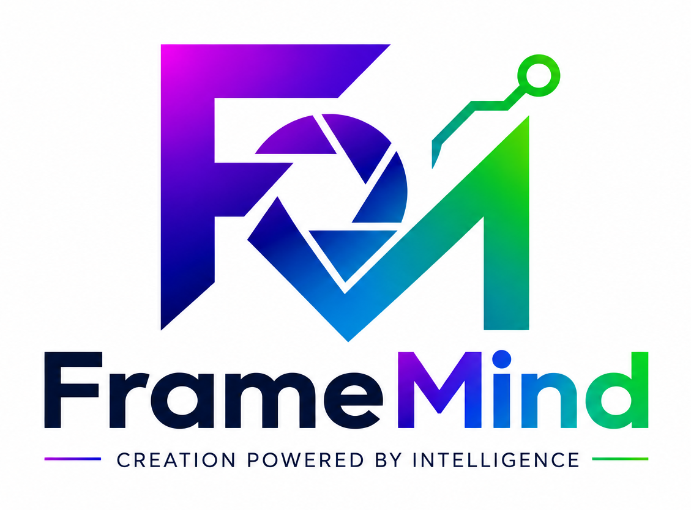

<div align="center">
  
  <h1>FrameMind Studio</h1>
  <p>A local Windows photo studio: import, select, adjust, retouch and export.</p>
  <p><a href="README.md">Česky</a> · <a href="README.en.md">English</a> · <a href="LICENSE">MIT</a></p>
</div>

FrameMind Studio is an open-source application run locally on your own computer.
GitHub hosts the source, backup and contributions; the application is not deployed.
The author and maintainer is [Lukáš Drštička (Lukedaca)](https://github.com/Lukedaca).

**Culling uses no AI:** it has no Gemini, API key, detection models or network calls.
The entire Studio is not fully offline yet: the editor still has two cloud features,
and retouch models and fonts are downloaded. See [Connections and data](#connections-and-data).

## Install on Windows

The desktop version uses **Tauri 2, Rust and Microsoft WebView2**. The React
interface runs in a dedicated application window. The installed application
does not require Vite, a terminal or an external browser.

**A client release is not available yet.** The 0.1.3 package on
[GitHub Releases](https://github.com/Lukedaca/framemind-studio/releases/tag/v0.1.3) is an unsigned
development preview. Do not distribute it to clients. Windows may show SmartScreen
or block installation; disabling protection is not part of the installation instructions.

Users do not need Git, Node.js or Rust. The installer includes an offline WebView2
installer for computers without the runtime, making it about 220 MiB.
Installation is per user, with shortcuts and standard uninstallation.
Preparing a client release requires a trusted publisher signature. Signing verifies
file origin and integrity; it does not guarantee immediate SmartScreen reputation.
[Microsoft's explanation](https://learn.microsoft.com/en-us/windows/apps/package-and-deploy/smartscreen-reputation).
macOS and Linux packages have not been built or verified.

Build, storage and verification details: [docs/desktop.md](docs/desktop.md).
Published release: [0.1.3](docs/releases/0.1.3.md).
Current changes on `main`: [full originals and local-1.4 culling](docs/releases/unreleased.md).
These fixes are not yet included in the installer attached to GitHub release 0.1.3.
Documentation index: [docs/README.md](docs/README.md).

## Develop and run from source

You need Git, Node.js 22 and npm. CI also uses Node 22.

```bash
git clone https://github.com/Lukedaca/framemind-studio.git
cd framemind-studio
npm ci
npm run dev
```

Open the address printed by Vite, usually **http://127.0.0.1:3000**.
Both dev and preview servers listen only on `127.0.0.1`.

```bash
npm run typecheck
npm run test:run
npm run build
npm run preview
```

The build is written to `dist/`; preview serves it locally, usually on port 4173.
GitHub Actions checks types, tests and both frontend builds. A separate Windows
workflow builds an artifact labeled `UNSIGNED-DEVELOPMENT-ONLY` and checks that
client release verification rejects it. Neither deploys the application.
Automatic Vercel deployments on Git changes are disabled in `vercel.json`.

Culling requires Web Workers, `createImageBitmap` inside a worker and
`OffscreenCanvas`. Without them, analysis reports an error rather than moving
heavy processing to the main thread. WebGPU retouching depends on the browser
and driver; a WASM path also exists. Dev and preview send cross-origin isolation headers.

Desktop builds also require Rust stable, MSVC C++ tools, the Windows SDK and WebView2.
See the [desktop guide](docs/desktop.md).

```bash
npm run desktop:dev
npm run desktop:build
```

The installer is written to `src-tauri/target/release/bundle/nsis/`.
`npm run build:desktop` only builds the frontend into `dist-desktop/`, not an installer.

## Current features

| Area | Current behavior |
|---|---|
| Import | JPEG, PNG, WebP; supported RAW extensions use an embedded JPEG preview |
| Culling | Technical metrics, similar frames, full originals with zoom, comparison of up to four frames and K / R / X decisions |
| Adjustments | Histogram-based auto adjustment, sliders and crop |
| Local retouching | Brush, click-based smart lasso and ONNX models in the local WebView or browser |
| Export | JPEG / PNG, quality, size and watermark; one photo or the set |
| Projects and clients | Local CRM and gallery preview in the application or browser profile |
| Interface | Czech and English; Windows desktop, PWA configuration for web builds only |

Adjustment previews are lossless PNGs with a maximum long edge of 1600 px.
Rendering runs in a worker and slider changes reuse the decoded photo;
intermediate requests are discarded. A bounded main-thread fallback is available
when workers are unsupported. Preview and export share the same rendering pipeline,
while export retains the selected resolution of the original photo. The working
preview is not a 1:1 inspection of the original image detail.

Adjustments, auto adjustment, cropping, retouching and restoring the original
share Undo/Redo history. One slider gesture is one step; up to 60 steps are kept
in each direction. Projects and the current workspace persist locally with image
copies and history across sessions. “Saved locally” confirms a completed write;
failed saves can be retried. Imported originals on disk are never overwritten.

Desktop exports use system dialogs for saving one photo or selecting a batch folder.
The web development version uses the File System Access API when available;
otherwise, individual files are downloaded through the browser.

## Culling without AI

Analysis processes one image at a time in a dedicated worker. It measures a preview
whose longer side is at most 768 px: luminance distribution, clipped highlights,
shadows, contrast, and detail, noise and directional blur indicators.
EXIF is read from the original input when available. You select a profile manually;
it changes technical score weights rather than analyzing image content.

Local engine 1.2 also measures up to nine unscaled 384 × 384 px samples from
larger sources. The strongest measured sample detail limits the sharpness score
so downscaling cannot hide blur. Samples are processed sequentially. This is
not subject detection; a small sharp object between sample positions can be missed.

The current source uses engine **local-1.4**. Click a photograph to open the whole
original image file without another conversion or compression. Select up to four
frames with `+` for comparison. The initial view fits the entire frame; 100%, 200%
and 400% reveal detail. Scroll to zoom and drag to pan. The 100% scale accounts
for display pixel density. K/R/X change the active frame's manual choice,
0 fits the image, 1 sets 100%, and Esc closes the viewer. RAW still displays
its embedded JPEG rather than developed sensor data.

Step-by-step instructions and shortcuts: [local culling guide (Czech)](docs/culling.md).

Repeated runs in the same application session reuse completed measurements of
the exact same input Blobs, including after cancellation. `Remeasure all` bypasses
this cache. Rehydrated files in a new session require new measurement; matching
names, sizes or timestamps never establish content identity. Relative series
comparisons use 1:1 evidence only when sufficient and source dimensions match.
Downscaling must not conceal severely soft original detail: rejection additionally
requires independently weak candidate detail, low noise and a sharp reference.
A sharp candidate sample vetoes that suggestion. Grouping reuses pair evidence already
collected instead of computing all of the same comparisons again.

- The 0–100 score shows its weighted contributions. It is not a probability of photo quality.
- Similarity uses image structure, colors and hashes. Series also use capture time
  or filename sequence. Grouping may miss similar images, especially in large
  sets with bounded candidate searches. Small camera translations are compensated
  for series comparisons; an aligned match alone does not establish a duplicate.
- Automatic suggestions include **keep**, **review** and **reject**. Reject suggestions
  have a specific reason: an almost empty clipped preview, a redundant near identical
  frame, substantially weaker detail than a stronger frame in a verified series,
  or widespread soft detail in informative 1:1 samples without an observed sharp patch.
- **K** = keep, **R** = review, **X** = reject.
- Manual choices survive reruns and profile changes.
- Choosing a series representative preserves the other images' manual decisions.
- Removing rejected images requires confirmation and removes them from the application set.
  Original files on disk are not deleted.
- A run can be stopped; completed measurements remain available.

Preview metrics do not assess eyes, expression, decisive moments, composition or
focus on a particular subject. The directional indicator does not prove motion blur.
Calibration covers one sports set of 114 JPEGs so far; it does not represent
different genres, cameras or RAW files.

RAW analysis measures the embedded JPEG, not sensor data. Camera processing affects
those measurements. Older automatic results require fresh analysis; manual choices take precedence.

## Local retouching

Brush retouching and click-based lasso run through ONNX Runtime Web in workers.
These paths do not send the photo to a cloud model or require an API key.

| Model | Task | Size from configured files |
|---|---|---|
| MI-GAN | Fast retouching | about 28 MB |
| LaMa | Detailed retouching | about 208 MB |
| SAM 2.1 tiny int8 | Click-based lasso masks | about 62 MB |

**Automatic** chooses MI-GAN for mask areas up to 14,400 pixels in original-image
dimensions and LaMa for larger areas. It does not recognize people.
The fast model is prepared when retouching opens; other models load as needed.

Retouching processes the mask's neighborhood at 512 × 512 and blends the result
back into the photo. The crop keeps its aspect ratio; reflected edges fill the
remaining model input. Canvas dimensions remain unchanged, but detail in large
filled areas is limited by model resolution. Retouch working copies use lossless
PNG, so repeated strokes do not add JPEG compression. JPEG remains available for
the final export. Working PNGs can take more space than the original JPEG.
The lasso offers candidate masks; exact outlines and fill quality are not guaranteed.
Performance depends on the device, browser and execution path.

## Connections and data

| Feature or resource | Connection / storage |
|---|---|
| Culling | No network calls, models or keys |
| Development dependencies | `npm ci` and the first Rust build download dependencies; installed users do not need them |
| Retouching and click-based lasso | Models load from Hugging Face at commit-pinned URLs; cached in the WebView or browser profile |
| Interface fonts | Google Fonts; web PWA caching rules apply only to web builds, desktop does not use PWA |
| Lasso by description | Still uses Gemini and sends a downscaled photo, longer side at most 1,536 px |
| Edit with text | Still sends the photo to Gemini |
| Projects, clients and current workspace | IndexedDB in the local profile; images, adjustments and history, without cross-device synchronization |

The two Gemini features belong only to the editor and need your own key.
Key storage is session-only by default; persistent storage requires confirmation.
They are not part of culling. Keys must not be committed or embedded in builds.

Caching may allow subsequent model use without internet, but cache availability
and quota are not guaranteed. PWA configuration alone does not establish full
offline operation of every feature.

The local profile **is not an independent photo backup**. IndexedDB stores image
copies separately from settings; slider changes do not rewrite image bytes.
Keep originals on disk and export results. Clearing profile data removes local
projects and stored image copies; a different host or port uses different storage.
Legacy `localStorage` JSON is kept intact and its metadata is read. Image bytes
that JSON never contained must be reimported; the affected project shows a notice.
Gallery preview is not a public photo-hosting service.

Desktop has a separate WebView2 profile under `%LOCALAPPDATA%\cz.framemind.studio\`.
Existing browser data is not migrated automatically. The new frontend uses the
same local IndexedDB storage. Workspace recovery was verified in isolated Chromium.
The local update to 0.1.3 preserved all 12 existing IndexedDB/localStorage files
before first launch, and the installed window opened. This check alone does not
verify recovery of every stored project. Deleting application data is a separate uninstall option.

## Limitations and verification

- RAW import extracts a preview; it does not perform demosaicing or full RAW development.
  Files without a usable embedded JPEG may fail to import.
- There are no user accounts, server storage or synchronization.
- All 147 tests passed for the current source, with synthetic culling checks in Chromium and native
  WebView2. One real set of 114 JPEGs verified measurement and unchanged originals;
  it does not establish general photographic accuracy or performance on a RAW set.
- Retouching has not been comprehensively verified across all browsers and GPUs.

Historical audit and implementation record: [docs/culling-local-audit.md](docs/culling-local-audit.md).
Older files in `docs/plans/` are proposals, not confirmation of current features.

## Contributions and license

Bug reports, changes and validation: [CONTRIBUTING.md](CONTRIBUTING.md).
Maintainer: [CONTRIBUTORS.md](CONTRIBUTORS.md).
Source code is licensed under [MIT](LICENSE). Dependencies and models have their
own licenses; model source links are in `utils/inpaintModels.ts` and `utils/segmentModel.ts`.
