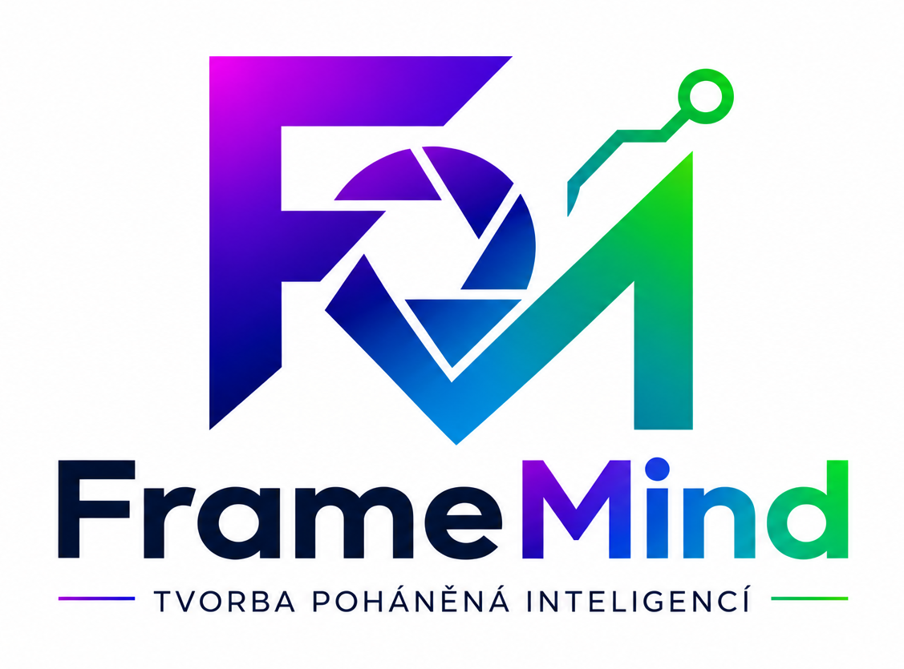

<div align="center">
  
  <h1>FrameMind Studio</h1>
  <p>Lokální desktopové fotostudio pro Windows: import, výběr, úpravy, retuš a export.</p>
  <p><a href="README.md">Česky</a> · <a href="README.en.md">English</a> · <a href="LICENSE">MIT</a></p>
</div>

FrameMind Studio je open-source aplikace pro lokální provoz na vlastním počítači.
GitHub slouží pro zdrojový kód, zálohu a příspěvky; aplikaci nikam nenasazujeme.
Autorem a správcem je [Lukáš Drštička (Lukedaca)](https://github.com/Lukedaca).

**Culling je kompletně bez AI:** nemá Gemini, API klíč, detekční modely ani síťová volání.
Celé Studio zatím není plně offline: editor stále obsahuje dvě cloudové funkce
a modely retuše i písma se stahují. Přesný stav je v části [Připojení a data](#připojení-a-data).

## Instalace do Windows

Desktopová verze používá **Tauri 2, Rust a Microsoft WebView2**. Rozhraní v Reactu
je zabalené v samostatném okně aplikace. Instalovaná aplikace nepotřebuje spouštět
Vite, terminál ani externí prohlížeč.

**Klientské vydání zatím není dostupné.** Balíček 0.1.5 v
[GitHub Releases](https://github.com/Lukedaca/framemind-studio/releases/tag/v0.1.5) je nepodepsaný
vývojový náhled. Nedoporučujeme jej distribuovat klientům. Windows může zobrazit
SmartScreen nebo instalaci zablokovat; vypínání ochrany není součástí instalačního postupu.

Uživatel nepotřebuje Git, Node.js ani Rust. Instalátor obsahuje offline instalační
program WebView2 pro počítače, kde runtime chybí; proto má přibližně 220 MiB.
Instalace je pro současného uživatele; aplikace má zástupce a standardní odinstalaci.
Pro přípravu klientského vydání je nutný důvěryhodný podpis vydavatele.
Podpis ověřuje původ a integritu souboru; sám negarantuje okamžité odstranění
varování SmartScreen. [Oficiální vysvětlení Microsoftu](https://learn.microsoft.com/en-us/windows/apps/package-and-deploy/smartscreen-reputation).
Vydání pro macOS a Linux nebyla sestavena ani ověřena.

Podrobnosti o sestavení, datech a ověření: [docs/desktop.md](docs/desktop.md).
Zveřejněné vývojové vydání: [0.1.5 — odezva retuše a opakované použití modelů](docs/releases/0.1.5.md).
Obsahuje adaptivní retuš, klonovací a hojivý štětec, celé originály a označení hlavního motivu.
Přehled dokumentace: [docs/README.md](docs/README.md).

## Vývoj a spuštění ze zdrojů

Potřebujete Git, Node.js 22 a npm. Node 22 používá také CI.

```bash
git clone https://github.com/Lukedaca/framemind-studio.git
cd framemind-studio
npm ci
npm run dev
```

Otevřete adresu vypsanou Vite, obvykle **http://127.0.0.1:3000**.
Dev i preview server naslouchají pouze na `127.0.0.1`.

```bash
npm run typecheck
npm run test:run
npm run build
npm run preview
```

Build vzniká v `dist/`; `preview` jej otevře na lokálním serveru, obvykle na portu 4173.
GitHub Actions provádí kontrolu typů, testy a oba frontendové buildy.
Samostatný Windows workflow sestavuje artefakt označený `UNSIGNED-DEVELOPMENT-ONLY`.
Ověřuje také odmítnutí nepodepsaného instalátoru kontrolou klientského vydání. Nic nenasazuje.
Automatické Vercel deploye při změnách v Gitu jsou vypnuté v `vercel.json`.

Pro culling musí prohlížeč podporovat Web Workers, `createImageBitmap` ve workeru
a `OffscreenCanvas`. Bez nich analýza ohlásí chybu; těžký výpočet se nepřesouvá
na hlavní vlákno. WebGPU retuše závisí na prohlížeči a ovladači; existuje také
WASM cesta. Dev i preview posílají hlavičky pro cross-origin izolaci.

Pro sestavení desktopové verze jsou navíc potřeba Rust stable, MSVC C++ nástroje,
Windows SDK a WebView2. Postup popisuje [desktopová dokumentace](docs/desktop.md).

```bash
npm run desktop:dev
npm run desktop:build
```

Instalátor vzniká v `src-tauri/target/release/bundle/nsis/`.
`npm run build:desktop` sestaví pouze frontend do `dist-desktop/`, nikoli instalátor.

## Co aplikace obsahuje

| Oblast | Současné chování |
|---|---|
| Import | JPEG, PNG, WebP; podporované RAW přípony se zpracují přes vložený JPEG náhled |
| Culling | Technické metriky, podobné záběry, celé originály se zoomem, porovnání až čtyř snímků a volby K / R / X |
| Úpravy | Automatická úprava z histogramu, posuvníky a ořez |
| Lokální retuš | Klonování, hojivý štětec, chytré laso, adaptivní výřezy, porovnání variant a místní ONNX modely |
| Export | JPEG / PNG, kvalita, velikost a vodoznak; jednotlivá fotka nebo sada |
| Projekty a klienti | Lokální CRM a náhled galerie v profilu aplikace nebo prohlížeče |
| Rozhraní | Čeština a angličtina; Windows desktop, PWA konfigurace pouze pro webový build |

Pracovní náhled úprav je bezeztrátový PNG s delší stranou nejvýše 1600 px.
Výpočet běží ve workeru a opakované posuny používají již dekódovanou fotku;
mezilehlé požadavky se zahazují. Bez podpory workeru je dostupný omezený náhled
na hlavním vlákně. Náhled i export používají stejný vykreslovací postup,
export ale zachovává zvolené rozlišení původní fotky. Pracovní náhled není
kontrola detailu originálu v měřítku 1:1.

Úpravy, automatika, ořez, retuš a obnovení originálu sdílejí historii Zpět/Znovu.
Jeden tah posuvníku tvoří jeden krok; historie drží nejvýše 60 kroků v každém
směru. Rozpracovaná sada i projekty se ukládají lokálně včetně snímků a historie
a obnoví se po nové relaci. Stav „Uloženo lokálně“ potvrzuje dokončený zápis;
při chybě lze uložení opakovat. Importované originály na disku se nepřepisují.

Desktop používá systémové dialogy pro uložení jedné fotky i výběr složky pro sadu.
Ve webovém vývojovém režimu ukládání používá File System Access API, pokud jej
prohlížeč nabízí; jinak se jednotlivé soubory stahují přes prohlížeč.

## Culling bez AI

Analýza běží po jednom snímku v samostatném workeru. Měří náhled s delší stranou
nejvýše 768 px: rozložení jasu, přepaly, stíny, kontrast, indikátory detailu,
šumu a směrového rozmazání. EXIF se podle dostupnosti čte z původního souboru.
Profil vyberete ručně; mění váhy technického skóre, nikoli obsahovou analýzu.

U větších zdrojů se měří až devět pevných výřezů 384 × 384 px bez zmenšení.
Engine 1.5 přidává nejvýše čtyři další výřezy podle struktury náhledu, včetně
oblastí mimo původní mřížku. Skóre a reference série vycházejí z pevných míst;
doplňkový ostrý detail může zabránit vyřazení a poslat snímek ke kontrole.
Výřezy se měří postupně. Nejde o detekci subjektu a důležitý detail lze stále minout.

Aktuální zdrojový kód používá engine **local-1.6**. Kliknutí na fotografii otevře
celý původní obrazový soubor bez dalšího převodu nebo komprese. Tlačítkem `+`
lze vybrat až čtyři snímky k porovnání. Výchozí pohled ukáže celý záběr;
100 %, 200 % a 400 % umožňují kontrolu detailu, kolečko mění zoom a tažení posouvá
fotografii. Měřítko 100 % zohledňuje hustotu displeje. K/R/X mění ruční volbu
aktivního snímku, 0 ukáže celý záběr, 1 nastaví 100 % a Esc náhled zavře.
U RAW se stále zobrazuje vložený JPEG, nikoli vyvolaná senzorová data.

V porovnání lze ručně **Označit hlavní motiv** a kliknutím určit oblast
128 / 256 / 384 px. Její ostrost v původním rozlišení pak vstupuje do skóre;
nejistý nebo měkký motiv vyžaduje kontrolu. Automatika sama subjekt nerozpoznává.
Nadbytečná kopie vyžaduje shodu všech dekódovaných pixelů JPEG/PNG nebo SHA-256
původních RAW dat; podobný náhled nestačí. Rozpor měření detailu ve dvou měřítkách
přidá důvod ke kontrole, sám nezpůsobí vyřazení.

Postup výběru a klávesové zkratky: [návod k lokálnímu cullingu](docs/culling.md).

Opakovaný běh ve stejné relaci používá hotová měření totožných vstupních
souborů; po zastavení tedy není potřeba znovu dekódovat dokončené snímky.
`Přeměřit vše` tuto cache obejde. Nová relace a obnovené soubory vyžadují nové
měření; shodný název, velikost ani čas souboru se nepovažují za důkaz totožnosti.
Při relativním porovnání série se výřezy 1:1 používají jen při dostatečné opoře
a stejných rozměrech zdrojů. Zmenšení nesmí zakrýt výrazně měkké originální
detaily: vyřazení pak navíc vyžaduje slabý detail samotného kandidáta, nízký šum
a ostrou referenci. Ostrý výřez kandidáta takový návrh blokuje.
Seskupování používá již provedená porovnání
místo opakovaného výpočtu stejných dvojic.

- Skóre 0–100 má rozpis jednotlivých příspěvků. Není to pravděpodobnost kvality snímku.
- Podobnost využívá obrazovou strukturu, barvy a hashe. Série navíc používají čas pořízení
  nebo návaznost názvů souborů. Seskupení nemusí najít všechny podobné snímky,
  zejména u velkých sad s omezeným hledáním kandidátů. Malý posun fotoaparátu
  se při porovnání sérií kompenzuje; taková shoda sama neznamená duplicitu.
- Automatika navrhuje **ponechat**, **zkontrolovat** i **vyřadit**. Vyřazovací návrhy
  mají konkrétní důvod: téměř prázdný plošně oříznutý náhled, nadbytečný téměř
  totožný záběr, výrazně slabší detail oproti lepšímu snímku ověřené série
  nebo široce doložené měkké detaily ve výřezech 1:1 bez nalezené ostré oblasti.
- **K** = ponechat, **R** = zkontrolovat, **X** = vyřadit.
- Ruční volby zůstávají při opakované analýze i změně profilu.
- Ruční výběr reprezentanta zachovává ruční verdikty ostatních snímků.
- Odebrání vyřazených vyžaduje potvrzení a odstraní je ze sady v aplikaci.
  Originály na disku se nemažou.
- Běh lze zastavit; hotová měření zůstávají k dispozici.

Náhledové metriky neposuzují oči, výraz, rozhodující moment, kompozici ani zaostření
na konkrétní subjekt. Směrový indikátor není důkaz pohybového rozmazání.
Kalibrace dosud zahrnuje jednu sportovní sadu 114 JPEGů; nejde o reprezentativní
ověření napříč žánry, fotoaparáty a RAW soubory.

Z RAW se měří vložený JPEG, nikoli RAW senzorová data. Jeho zpracování ve fotoaparátu
ovlivňuje měření. Starší automatické výsledky vyžadují novou analýzu;
ruční rozhodnutí mají přednost.

## Lokální retuš

**Klonování** kopíruje skutečnou texturu ze vzorku vybraného pomocí Alt + kliknutí.
**Hojivý štětec** přenese jemnou texturu a přizpůsobí její barevnost cílovému místu.
Oba nástroje pracují bez modelu, zachovávají sílu masky a společnou historii.
U modelové retuše lze vypnout konzervativní sjednocení barvy na hladkém okraji masky.

Modelová štětcová retuš a klikací laso běží přes ONNX Runtime Web ve workerech.
Tyto cesty fotku neposílají do cloudového modelu a nevyžadují API klíč.

| Model | Úloha | Velikost podle souborů v konfiguraci |
|---|---|---|
| MI-GAN | Rychlá retuš | přibližně 28 MB |
| LaMa | Detailní retuš | přibližně 208 MB |
| SAM 2.1 tiny int8 | Masky pro klikací laso | přibližně 62 MB |

Volba **Automaticky** používá MI-GAN pro retušovanou oblast do 14 400 pixelů
v rozměrech původní fotky a LaMa pro větší oblast. Model se volí pro každou
zpracovávanou oblast zvlášť; neprovádí rozpoznávání lidí.
Rychlý model se připravuje při otevření retuše; další modely se načítají podle potřeby.

Vzdálené části masky dostanou vlastní výřezy místo společného zmenšení celé oblasti.
Blízké části s překrývajícím se okolím se slučují; počet zpracovávaných oblastí je
omezen na 16. Souvislý objekt se nerozděluje na dlaždice. **Okolí retuše** nabízí
vyvážený výřez, jemný detail s těsnějším výřezem nebo širší okolní scénu.
Volba **Porovnat varianty před použitím** nejprve připraví až tři odlišné výřezy
stejné masky. Do fotky se vloží až vybraný výsledek jako jeden krok historie;
zrušení ani Escape fotografii nemění. Shodné výřezy se zobrazí jen jednou.

Výchozí vstup modelu zůstává 512 × 512. U explicitní volby **Detailní** lze zapnout
**Vyšší detail** až 1024 × 1024; malé výřezy zůstávají na 512 × 512. Používají se
stejné váhy LaMa: v paměti se upraví pouze metadata rozměrů vstupu, stažený soubor
ani jeho cache se nemění. Vyšší rozlišení potřebuje více paměti a času a nemusí
vytvořit lepší výsledek. Automatický a rychlý režim používají 512 × 512.

Výřez zachovává proporce; zbývající plochu vstupu vyplní zrcadlené okraje a výsledek
se prolne zpět do fotky. Rozměry plátna zůstávají zachované; detail doplněné velké
oblasti je stále omezený vstupem modelu. Pracovní kopie retuše se ukládá
bezeztrátově do PNG, takže
opakované tahy nepřidávají JPEG kompresi. JPEG lze zvolit při konečném exportu.
Pracovní PNG může zabírat více místa než původní JPEG.
Laso poskytuje kandidátní masky; přesný obrys ani kvalita doplnění nejsou zaručené.
Výkon závisí na zařízení, prohlížeči a zvolené výpočetní cestě.

## Připojení a data

| Funkce nebo zdroj | Připojení / uložení |
|---|---|
| Culling | Žádná síťová volání, modely ani klíče |
| Vývojové závislosti | `npm ci` a první Rust build stahují závislosti; instalovaný uživatel je nepotřebuje |
| Retuš a klikací laso | Modely se načítají z Hugging Face, URL jsou připnuté na commit; cache je v profilu WebView nebo prohlížeče |
| Písmo rozhraní | Google Fonts; webová PWA má pravidla pro jejich cache, desktop PWA nepoužívá |
| Laso podle popisu | Stále používá Gemini a posílá zmenšenou fotografii, delší strana nejvýše 1 536 px |
| Úprava textem | Stále posílá fotografii do Gemini |
| Projekty, klienti a rozpracovaná sada | IndexedDB v místním profilu; snímky, úpravy a historie, bez synchronizace mezi zařízeními |

Dvě Gemini funkce patří pouze do editoru a vyžadují vlastní klíč. Výchozí uložení
klíče je na relaci; trvalé uložení vyžaduje potvrzení. Nejsou součástí cullingu.
Klíč nepatří do repozitáře ani do buildu.

Cache může umožnit další použití modelů bez internetu, ale její dostupnost a kvóta
nejsou zaručené. PWA konfigurace sama nedokazuje úplný offline provoz všech funkcí.

Místní profil **není nezávislá záloha fotografií**. IndexedDB ukládá kopie snímků
odděleně od nastavení, při posunu posuvníku se znovu nezapisují obrazová data.
Ponechte originály na disku a výsledky exportujte. Smazání dat profilu odstraní
místní projekty i uložené kopie; změna hostu nebo portu používá jiné úložiště.
Starší JSON z `localStorage` zůstává zachovaný a jeho metadata se přečtou.
Obrazová data, která JSON nikdy neobsahoval, je nutné importovat znovu; aplikace
to u takového projektu zobrazí. Náhled galerie není veřejný hosting fotografií.

Desktop má vlastní profil WebView2 pod `%LOCALAPPDATA%\cz.framemind.studio\`.
Data z původního prohlížeče se do něj automaticky nepřenesou. Nový frontend používá
stejné místní IndexedDB úložiště. Obnova pracovního stavu byla ověřena v odděleném
Chromiu. Při místní aktualizaci na 0.1.3 zůstalo všech 12 existujících souborů
IndexedDB a localStorage před prvním spuštěním beze změny a instalované okno se
otevřelo; tato kontrola sama neověřuje obnovu každého uloženého projektu.
Při odinstalaci je odstranění dat samostatná volba.

## Omezení a ověření

- RAW import extrahuje náhled; nejde o demosaicing ani plné vyvolání RAW.
  Soubor bez použitelného vloženého JPEG nemusí jít importovat.
- Nejsou zde uživatelské účty, serverové úložiště ani synchronizace.
- Rozsah aktuálního i historického ověření popisují [poznámky k 0.1.5](docs/releases/0.1.5.md).
  Syntetické kontroly a místní fotografické sady neprokazují obecnou přesnost
  napříč žánry, fotoaparáty a RAW soubory.
- Kompletní ověření retuše ve všech prohlížečích a na všech GPU nebylo provedeno.

Historický audit a záznam implementace: [docs/culling-local-audit.md](docs/culling-local-audit.md).
Starší soubory v `docs/plans/` jsou návrhy, nikoli potvrzení současných funkcí.

## Příspěvky a licence

Postup pro bug reporty, změny a ověření: [CONTRIBUTING.md](CONTRIBUTING.md).
Správce: [CONTRIBUTORS.md](CONTRIBUTORS.md).
Zdrojový kód je pod [licencí MIT](LICENSE). Závislosti a modely mají vlastní licence;
odkazy na použité modely jsou v `utils/inpaintModels.ts` a `utils/segmentModel.ts`.
