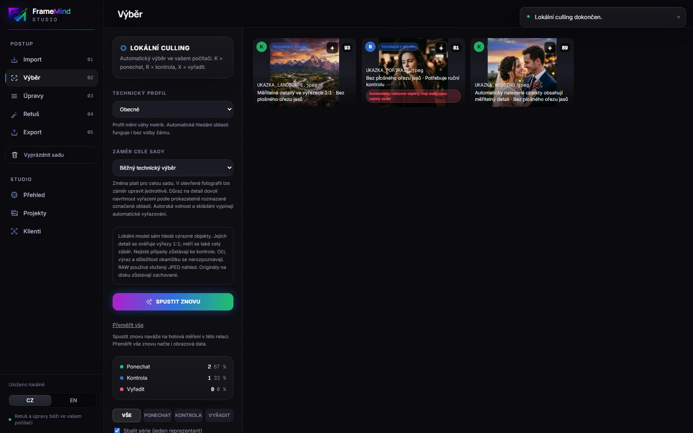
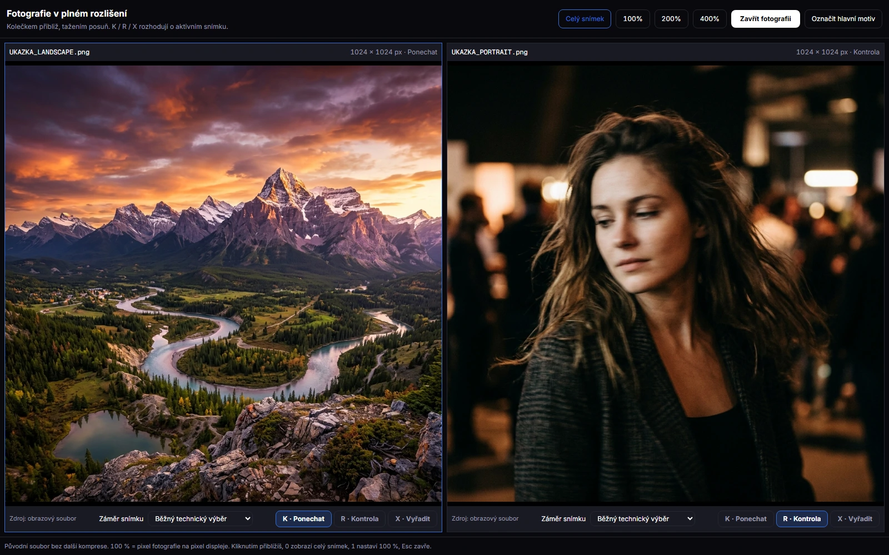

# FrameMind Studio 0.1.7 interface

Captured on 1 November 2026 from the current production frontend build with
`scripts/capture-release-ui.mjs`, in an isolated Chromium profile. The images
use already-public demonstration photographs, with no private client records.
These show development source 0.1.7 / local-1.8; the public installer remains 0.1.6.
Browser captures are interface evidence. Native runtime verification is documented
in [the current change notes](../docs/releases/unreleased.md).

Other screens: [overview](studio-v017-20261101-home.webp),
[import](studio-v017-20261101-import.webp), [editor](studio-v017-20261101-edit.webp),
[retouching](studio-v017-20261101-retouch.webp), [export](studio-v017-20261101-export.webp),
[projects](studio-v017-20261101-projects.webp), [clients](studio-v017-20261101-clients.webp).
