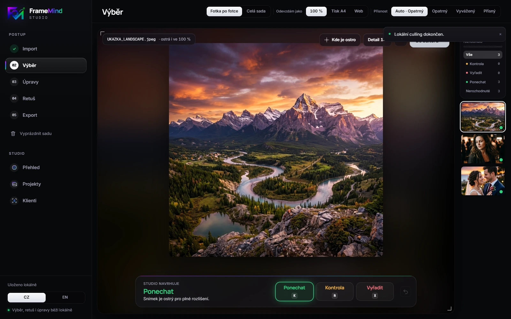
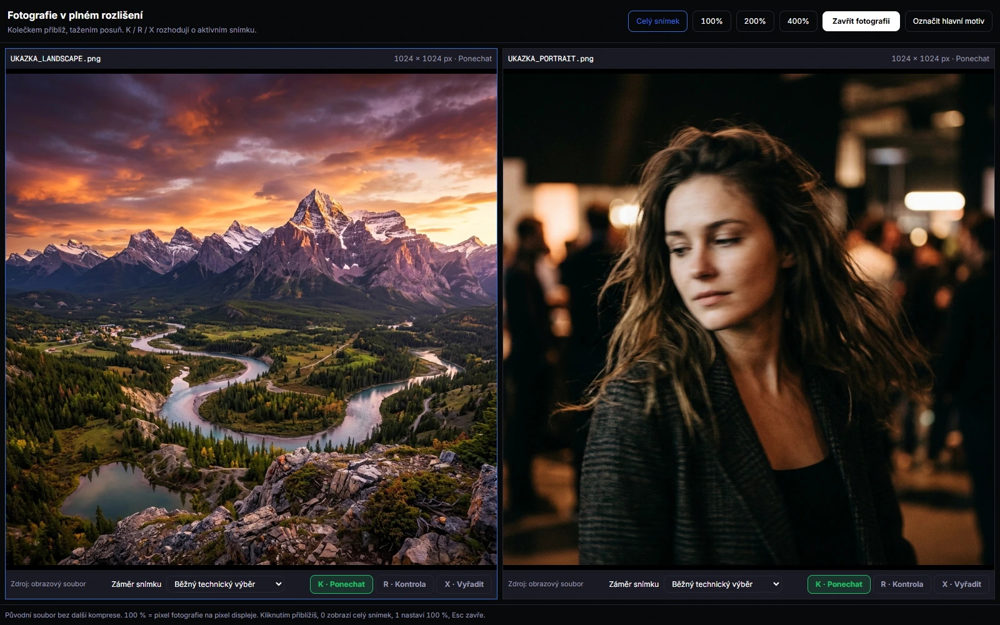

# FrameMind Studio 0.1.8 interface

Captured on 21 November 2026 using `scripts/capture-release-ui.mjs` in Chromium
with an isolated profile and already-public demonstration photographs. No private
client records are used. The images show release source 0.1.8 / local-2.0.
Browser captures are interface evidence; Windows runtime checks and their limits
are documented in [the release notes](../docs/releases/0.1.8.md).

Other screens: [overview](studio-v018-20261121-home.webp),
[import](studio-v018-20261121-import.webp), [whole set](studio-v018-20261121-grid.webp),
[editor](studio-v018-20261121-edit.webp), [retouching](studio-v018-20261121-retouch.webp),
[export](studio-v018-20261121-export.webp), [projects](studio-v018-20261121-projects.webp),
[clients](studio-v018-20261121-clients.webp).
