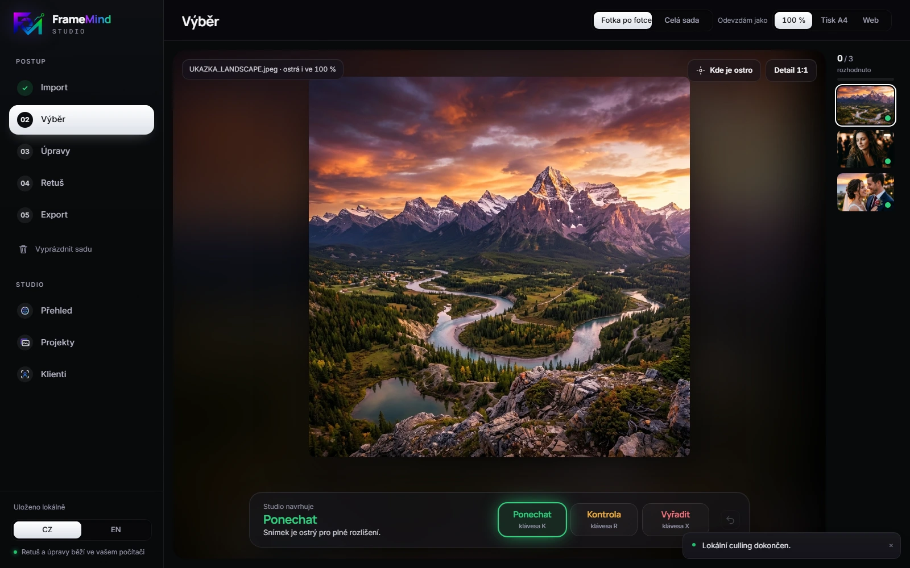

# FrameMind Studio 0.1.7 interface

Captured on 14 November 2026 using `scripts/capture-release-ui.mjs` in Chromium
with an isolated profile and already-public demonstration photographs. No private
client records are used. The images show release source 0.1.7 / local-2.0.
Browser captures are interface evidence; Windows runtime checks and their limits
are documented in [the release notes](../docs/releases/0.1.7.md).

Other screens: [overview](studio-v017-20261114-home.webp),
[import](studio-v017-20261114-import.webp), [whole set](studio-v017-20261114-grid.webp),
[editor](studio-v017-20261114-edit.webp), [retouching](studio-v017-20261114-retouch.webp),
[export](studio-v017-20261114-export.webp), [projects](studio-v017-20261114-projects.webp),
[clients](studio-v017-20261114-clients.webp).
